# wireguard-operator

A Kubernetes operator that runs a WireGuard server inside your cluster and admits pods to it by
public key, declaratively. It is the base of an in-cluster VPN gateway: application pods tunnel to
the server, and the server egresses through [gluetun](https://github.com/qdm12/gluetun) to a
commercial VPN provider. The server and peer registration work today; the gluetun egress and the
in-pod client are designed, not yet implemented.

This is a fork of [jodevsa/wireguard-operator](https://github.com/jodevsa/wireguard-operator) that
trims it to an in-cluster gateway — no LoadBalancer or NodePort Service, no wstunnel, no IPv6, no
client private keys held by the operator — and reconciles what is left with Server-Side Apply; see
[What's changed in this fork](#whats-changed-in-this-fork).

The operator is **not** a VPN for phones or laptops. The server is reachable in-cluster only,
through a ClusterIP Service.

> [!WARNING]
> **Agentically generated.** This codebase was produced through agentic,
> spec-driven development: each feature began as a written design and
> implementation spec, then a coding agent executed the plan under human
> review. Tests, code review, and CI gates apply as they would for any
> project, but the authorship pattern is not a single human contributor —
> keep that in mind when evaluating fit for your environment.

## What it does

- **`Wireguard`** — the server. The operator generates the server key pair and keeps it in a
  Secret, runs a single-replica Deployment with the WireGuard agent, and exposes UDP `51820`
  through a ClusterIP Service.
- **`WireguardPeer`** — a client, identified by its public key. The operator allocates the peer an
  address from the server's `peerCIDR` (default `10.8.0.0/24`), and the agent adds it to the
  server's `wg0`. The operator never sees the client's private key.
- **Kernel or userspace WireGuard** — the agent uses the kernel module when the node has it and
  falls back to [wireguard-go](https://github.com/WireGuard/wireguard-go) when it does not.
- **Egress through gluetun** *(designed, not yet implemented)* — the server pod forwards peer
  traffic into a gluetun sidecar and fails closed when the tunnel drops. See
  [docs/gluetun-egress.md](docs/gluetun-egress.md).
- **Client sidecar** *(designed, not yet implemented)* — a native sidecar that mints a key inside
  the application pod, registers it, and routes the pod's internet traffic through the server.
  See [docs/client-sidecar.md](docs/client-sidecar.md).

See [`docs/architecture.md`](docs/architecture.md) for how the two resources fit together.

## At a glance

How traffic flows from an application pod to the VPN provider; the client sidecar and the gluetun hop are not built yet:



Where it runs: the operator in `wireguard-system`, and one gateway pod per `Wireguard` in the namespace of its clients.



## Quick start

**Prerequisites:** a Kubernetes cluster, `kubectl` pointed at it, Go 1.26, and `wireguard-tools`
for `wg` on your workstation. The gateway's namespace must allow privileged pods. (Full
prerequisites, manager flags and building your own images:
[`docs/installation.md`](docs/installation.md).)

**1. Install the operator.** Helm: not yet available. Install from source (below). Tracked in
[#48](https://github.com/jacaudi/wireguard-operator/issues/48).

```sh
git clone https://github.com/jacaudi/wireguard-operator.git
cd wireguard-operator
make deploy IMG=ghcr.io/jacaudi/wireguard-operator/manager:latest
```

`make deploy` requires `IMG`, the manager image, and has no default for it. The agent image is set
separately, to `ghcr.io/jacaudi/wireguard-operator/agent:latest`, in
[`config/default/manager_args_patch.yaml`](config/default/manager_args_patch.yaml). Both `latest`
tags are built from `main`; no release is published yet. The operator runs in the `wireguard-system`
namespace:

```sh
kubectl -n wireguard-system rollout status deployment/wireguard-controller-manager
```

**2. Create a gateway** ([`examples/01-server.yaml`](examples/01-server.yaml)). Apply this and the
peer below with `kubectl apply -f`, in the same namespace:

```yaml
apiVersion: vpn.wireguard-operator.io/v1alpha1
kind: Wireguard
metadata:
  name: vpn
spec: {}
```

**3. Register a peer.** Each peer generates its own key and registers only the public half:

```sh
wg genkey | tee peer.key | wg pubkey
```

```yaml
apiVersion: vpn.wireguard-operator.io/v1alpha1
kind: WireguardPeer
metadata:
  name: peer1
spec:
  wireguardRef: vpn
  publicKey: "<public key>"  # the output of wg pubkey above
```

The operator does not run a client for you yet. Keep `peer.key` and configure a WireGuard client
yourself with the values in
[Client sidecar — Today](docs/client-sidecar.md#today-configure-the-client-yourself).

**4. Check status.**

```sh
kubectl get wireguard vpn                                       # STATUS: ready
kubectl get wireguardpeer peer1                                 # STATUS: ready
kubectl get wireguardpeer peer1 -o jsonpath='{.spec.address}'   # the peer's tunnel address
```

Both read `ready` within a few reconciles. A peer without a `publicKey` stays `pending` with the
`PublicKeyMissing` condition.

## How it works

One manager, one agent image, and one pod per server. The manager reconciles the CRDs into
ordinary Kubernetes objects; the agent inside the server pod turns a JSON state file into a
configured `wg0`.

- **Manager** — watches `Wireguard` and `WireguardPeer`. For each `Wireguard` it applies the
  Service and Deployment with Server-Side Apply, creates the key Secret once, allocates peer
  addresses, and writes the desired server state into that Secret as `state.json`.
- **Server pod** — a privileged `sysctl` init container enables IPv4 forwarding, then the `agent`
  container (with `NET_ADMIN`) creates `wg0`, takes the first host of `peerCIDR` as its address,
  and listens on UDP `51820`.
- **Agent** — watches the mounted `state.json` and adds, updates or removes peers by public key,
  each with its `/32` as `AllowedIPs`. Its `/health` endpoint backs the pod's readiness probe.
- **Peer identity** — a peer is its public key. The private key stays wherever the client
  generated it; the operator neither mints nor stores it.

## What's changed in this fork

Beyond the upstream project, this fork:

- **Removes external-client exposure** — the Service is always ClusterIP; `serviceType`, `port`,
  `address`, `externalAddress` and `serviceAnnotations` are gone, and so is wstunnel.
- **Removes operator-held client keys** — peers bring their own `publicKey`; the operator no
  longer mints peer keys, reads `privateKeyRef`, or renders a peer configuration Secret.
- **Removes the server iptables sync, IPv6, per-peer policy, server-pushed DNS and the metrics
  exporter** — none has a consumer in an in-cluster gateway, and the iptables sync replaced the
  pod's whole `nat` and `filter` tables on every peer change.
- **Reconciles with Server-Side Apply** — the Service and Deployment converge on every reconcile,
  with field ownership migrated from the upstream manager.
- **Publishes its own images and releases** — `ghcr.io/jacaudi/wireguard-operator/{manager,agent}`,
  the Go module `github.com/jacaudi/wireguard-operator`, and **automated releases**
  (release-please → SemVer tags and changelog).

Coming from upstream? Read [docs/upgrading-from-upstream.md](docs/upgrading-from-upstream.md).

## Documentation

Full docs live in [`docs/`](docs/):

- [Installation](docs/installation.md) · [Architecture](docs/architecture.md)
- [`Wireguard`](docs/crd-wireguard.md) · [`WireguardPeer`](docs/crd-wireguardpeer.md) references
- [Gluetun egress](docs/gluetun-egress.md) · [Client sidecar](docs/client-sidecar.md) — designed, not yet implemented
- [Upgrading from upstream](docs/upgrading-from-upstream.md) · [Examples](examples/)

## Acknowledgements

- **[Subhi Al Hasan (jodevsa)](https://github.com/jodevsa)** — the author of
  [wireguard-operator](https://github.com/jodevsa/wireguard-operator), which this project is forked
  from. The two CRDs, the agent's netlink and wgctrl code, the kernel-to-userspace fallback and
  the IP allocator are his work; this fork keeps them and removes the parts an in-cluster gateway
  does not need. Thank you for building it and keeping it open! GitHub lists
  this repository as a fork of [NCCloud/wireguard-operator](https://github.com/NCCloud/wireguard-operator),
  which carries the same history; thanks to everyone who contributed there.
- **[qdm12](https://github.com/qdm12)** — the author of [gluetun](https://github.com/qdm12/gluetun),
  the VPN client the egress design builds on.
- **[angelnu](https://github.com/angelnu)** — [pod-gateway](https://github.com/angelnu/pod-gateway)
  is the prior art for routing a pod's traffic through an in-cluster gateway and failing closed by
  routing.
- [WireGuard](https://www.wireguard.com/), [wireguard-go](https://github.com/WireGuard/wireguard-go)
  and [wgctrl](https://github.com/WireGuard/wgctrl-go) for the tunnel itself, and
  [Kubebuilder](https://github.com/kubernetes-sigs/kubebuilder) for the scaffolding.

## License

[MIT](LICENSE)
